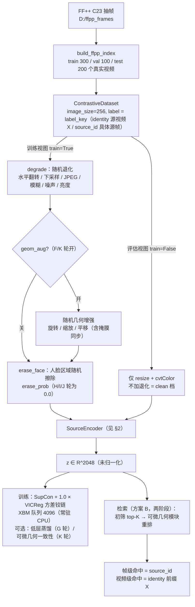
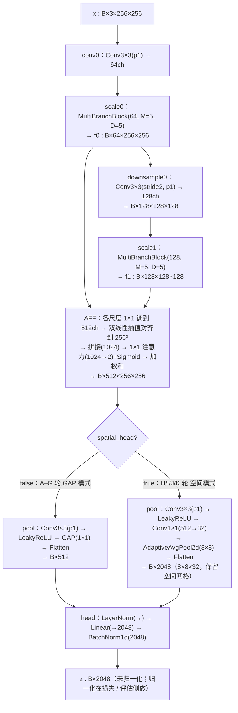
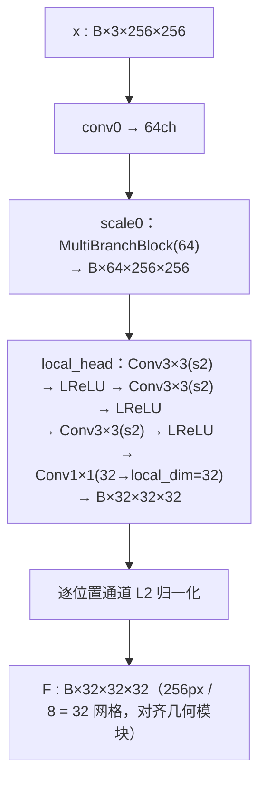
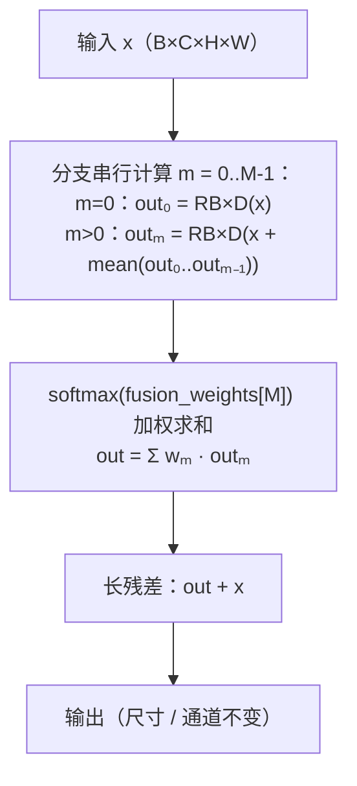
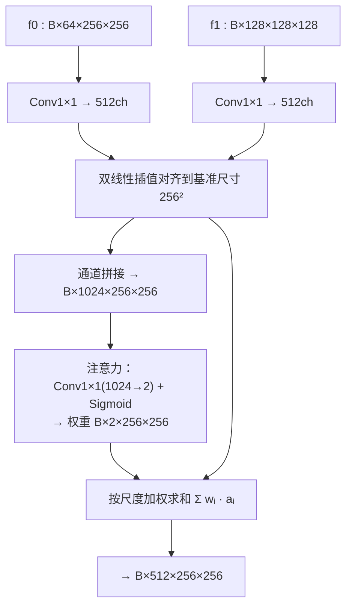
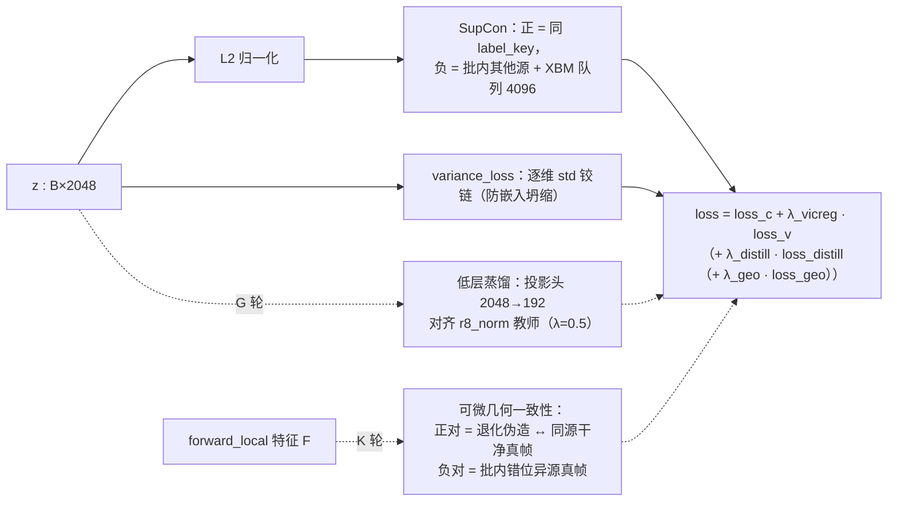
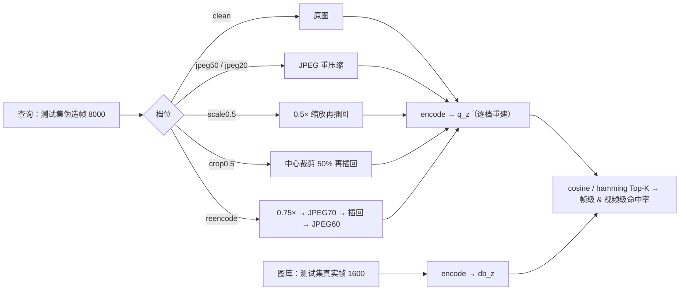
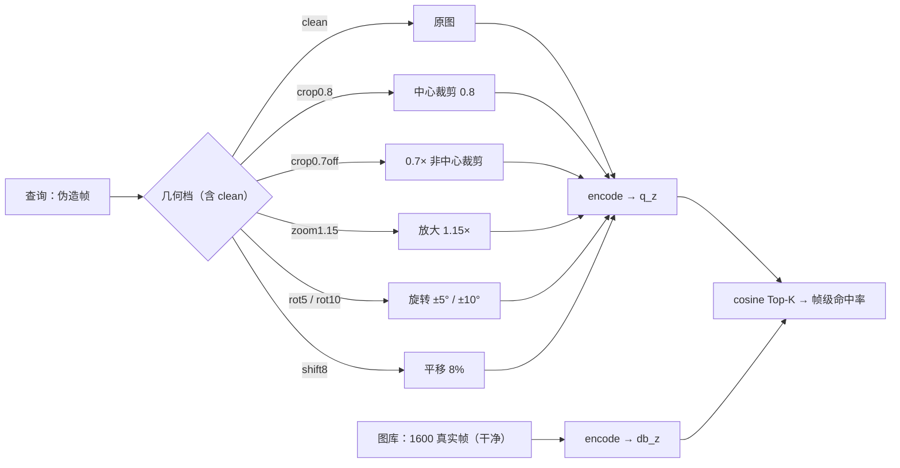
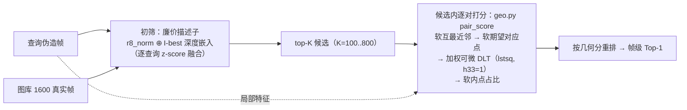

# AURA 模型结构设计图（mermaid）

> 用途：把 `aura/` 自建单编码器的**实际结构**画成图，供讨论 / 交接 / 写论文时参考。
> 维护约定：**代码是唯一事实来源**，本文件随结构改动同步更新（改动清单见文末「同步记录」）。
> 对应代码：[encoder.py](file:///d:/py/AURA/aura/encoder.py)、[data.py](file:///d:/py/AURA/aura/data.py)、[geo.py](file:///d:/py/AURA/aura/geo.py)、[eval.py](file:///d:/py/AURA/aura/eval.py)、[train.py](file:///d:/py/AURA/aura/train.py)
> 日期：**2026-10-20（F–K2 轮：去 GAP 空间头 + 局部描述子头 + 可微几何支路 + 方案 B 两阶段重排器）**

***

## 1. 端到端总览（数据 → 编码 → 损失 / 检索）

***

## 2. SourceEncoder 前向（全量规格：256px / M=5 / D=5 / 64ch / aff512 / embed2048）

### 2.1 主干 → 池化段（两种模式）→ 全局头

> 注①：`use_multiscale_skip=true` 时每条 scale 在**降采样前**生成一条 `GAP → Linear(·→512)` 的 lateral，concat 进 head（head 输入 512→1536，参数 12.82M→15.02M）；当前各轮**始终关闭**，且已发现其 `AdaptiveAvgPool2d(1)` 不含空间相位 ⇒ 结构上无法修复帧级（见 HANDOFF §3.9 第 3 条）。
> 注②：`spatial_head=true` 只对 head 前的**池化段**做空间保留，head 本身不变；`embed_dim(2048)` 必须能被 `pool_grid²(64)` 整除。

### 2.2 局部描述子支路（`local_head`，K 轮新增；`forward_local`）

> 关键设计：`forward_local` **只跑到共享主干早期（conv0→scales[0]）**，不经 AFF/pool/head（那是 256px 下显存与算力的大头），但沿途参数与全局检索路径**共享** ⇒ 几何一致性损失的梯度能回传到 conv0/scales[0]，从而塑形检索表征。这正是 K 轮"几何损失进网络"与独立外挂重排器的区别（也是它失败的原因，见 HANDOFF §3.10 结论 5）。
> 独立外挂版不走主干：`LocalDescriptor`（`dim=32, width=32, depth=3`）**自己做稠密自监督 InfoNCE**（`_train_local_desc.py`），是方案 B 里表现最好的特征源（见 §7）。

***

## 3. MultiBranchBlock（主干的基本单元，M=5 分支 × D=5 残差块）

`ResidualBlock`（D 个串联）：`Conv3×3 → LeakyReLU → Conv3×3 → 残差相加 → LeakyReLU`。

***

## 4. AttentionFeatureFusion（AFF，把两个尺度对齐后按注意力加权）

***

## 5. 损失

- **SupCon（tau=0.2）+ 1.0 × variance_loss**：主线恒开。
- **低层蒸馏（G 轮）**：投影头 `2048→192` 对齐逐图标准化缩略图教师 `r8_norm`，λ=0.5；**结论：零增益**（e6 47.04 < A 轮 47.75）。
- **可微几何一致性（K 轮）**：正对 = 同 `source_id` 组的「干净真帧 ↔ 随机几何退化的伪造帧」，负对 = 批内错位异源真帧；铰链 margin=0.3，λ_geo=1.0，`temp=0.05`、`sigma=0.08`、`grid=32²`。**结论：双重证伪**（K 58.71 / K2 57.96 均低于 I-best 59.68）。

***

## 6. 退化基准（只作用于查询；图库保持干净且只编码一次）

### 6.1 光度六档（A–E 轮，`DEGRADATION_LEVELS`）

### 6.2 几何七档（F–K2 轮，`GEOM_LEVELS`）

> 脚本：光度六档走 [eval.py `evaluate_degradation`](file:///d:/py/AURA/aura/eval.py)；几何七档走一次性脚本 [\_eval_geom_model.py](file:///d:/py/AURA/aura/runs/_eval_geom_model.py)（逐档重建查询嵌入）。

***

## 7. 方案 B：两阶段检索器（可微几何模块替代 SIFT+RANSAC）

- 特征源两选：`local_head`（K 轮挂主干的局部头）/ `local`（**独立训练的 `LocalDescriptor`**）。
- `pair_score` 全链可微、**无 SIFT / 无 RANSAC**；`temp=0.05`、`sigma=0.08`、`grid=32²`（N=1024）。
- 读数（K=300，n_query=300）：`local` 均值 **66.52%** vs 经典 SIFT+RANSAC **67.57%**（−1.05pp，7 档 4 档反超）；`local_head` 63.91%。详见 HANDOFF §3.11。

***

## 8. 关键规格与工程决策（与图对照）

| 项 | 取值 | 说明 |
| --- | --- | --- |
| 输入 / 输出 | 256×256×3 → R^2048 | 整图输入，无前景/背景分离 |
| 主干 | M=5（分支）× D=5（残差块）× 2 尺度 | 沿用论文"全量规格"以保持可比性 |
| 通道 | 64ch（尺度0）→ 128ch（尺度1）→ aff 512 | |
| 嵌入头 | **两种模式**：GAP（A–G 轮，默认，输出 512）；**空间保留 `spatial_head`（H/I/J/K 轮主线）**：`Conv1×1(512→32) → AdaptiveAvgPool2d(8×8) → Flatten` = 8×8×32 = 2048 | 去 GAP 是自建线唯一的架构级跃升（+12pp）；GAP 的 65536:1 多对一满射是帧级瓶颈（HANDOFF §3.9） |
| 多尺度跳连 | `use_multiscale_skip`：每尺度降采样前特征图 → GAP → Linear(·→512) | 当前各轮**关闭**；已知其 `AdaptiveAvgPool2d(1)` 不含空间相位，无法修复帧级 |
| 局部描述子头 | `local_head`（K 轮）：共享 `conv0→scales[0]`，3 层 stride2 → (B,32,32,32)，逐位置 L2 归一化 | 供几何支路；梯度可回传共享主干。独立版见 `LocalDescriptor`（`_train_local_desc.py`） |
| 人脸擦除 | `erase_prob` 概率擦除人脸区（噪点/纯色/空洞/随机椭圆），阈值只在 (0.35,0.65) 随机 | BiSeNet 掩膜实测占画面约 **55%** 且近似二值（阈值抬到 0.7 面积仅 0.556→0.551），**强度只能靠 `erase_prob` 控**；H/I/J/K 轮为 **0.0** |
| head | LayerNorm → Linear → BatchNorm1d | LayerNorm 防 fp16 溢出根因；BN 打破初始对称性（防坍缩） |
| 前向精度 | 整段 **fp32**（`autocast(enabled=False)`） | fp16 下多分支激活幅值 O(1e3) 会溢出成 inf → NaN |
| 梯度检查点 | 可配；E/F/H/K 轮**开**（峰值 ~7.6GB）、I/J 轮**关**（22GB 富余换回 ~25–30% 算力） | 梯度数值等价，不改变训练动力学 |
| 监督粒度 | `label_key`：`source_id`（当前各轮，具体源帧 `X_f{帧号}`）/ `identity`（粗粒度备选） | 与帧级判据对齐；真正的难点是"同视频相邻帧"这种近乎相同的极难负样本 |
| batch / step | 2 源 × 2 张 = 4；800 步/轮 × 6 轮（K 轮 1 epoch 看方向） | 300 源 → 每轮只过约 22% 数据 |
| 损失 | SupCon（tau=0.2）+ 1.0 × variance_loss（+ 可选 蒸馏 λ0.5 / 几何一致性 λ1.0） | XBM 队列 4096 常驻 CPU |
| 几何模块超参 | `temp=0.05` / `sigma=0.08` / `margin=0.3` / grid 32²（N=1024） | sigma=0.08 > 网格单元 2/32=0.0625，软内点近乎失效（**未调优**） |
| 评测 | 图库 1600 真实帧 / 查询 8000 伪造帧 | 帧级 = source_id 命中；视频级 = 同源 X；光度六档 + 几何七档 |
| kill 硬线 | 帧级 Top-1 **> 60.05%**（零训练 `r8_norm`，2026-10-18 上移） | 自建线 best **59.68%（I e1）仍未过线** |

***

## 9. 同步记录

| 日期 | 同步内容 |
| --- | --- |
| 2026-10-17 | 新建；对齐 C 轮结构（identity + 人脸擦除 + 多尺度跳连，15.02M）与退化基准六档 |
| 2026-10-17 | C 轮（erase 0.5 + 跳连）帧级 Top-1 e1 32.23% → e2 13.06% 崩盘；改单变量隔离轮 `_erase_lite`（仅擦除、`erase_prob` 0.2、跳连关闭、12.82M）。补记掩膜近似二值、面积约 55% 的实测 |
| 2026-10-18 | `label_key` 改为可配置（identity / source_id），当前轮 `_fine` 用 `source_id`；规格表「监督粒度」「人脸擦除」「batch/step」行同步。结构本身未变 |
| 2026-10-20 | **F–K2 轮同步**：① §2 拆成「主干→池化段（GAP / **空间保留** 两模式）→全局头」与「局部描述子支路 `forward_local`」；② 新增 §7「方案 B 两阶段检索器（`geo.py pair_score`）」，插入原 §7→**§8 规格表**、§8→**§9 同步记录**；③ §5 损失补 蒸馏（G）/ 几何一致性（K）；④ §6 拆出**几何七档**；⑤ §1 总览加 `geom_aug` 与两阶段检索；⑥ 规格表补 `spatial_head` / `local_head` / 几何超参 / kill 硬线 60.05% 各行 |
