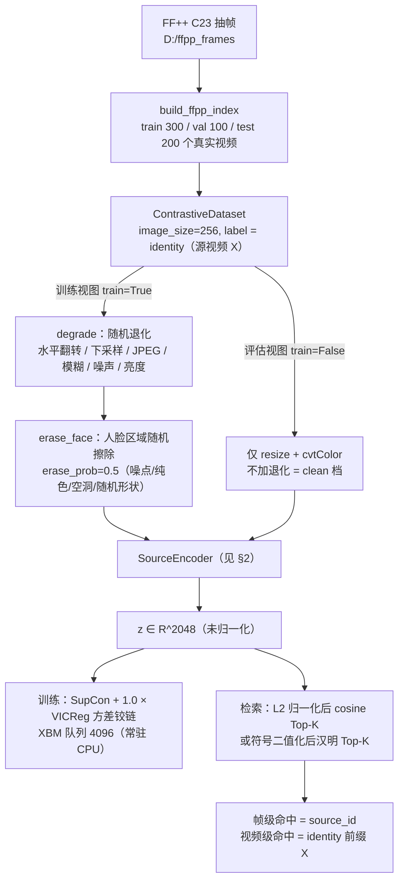
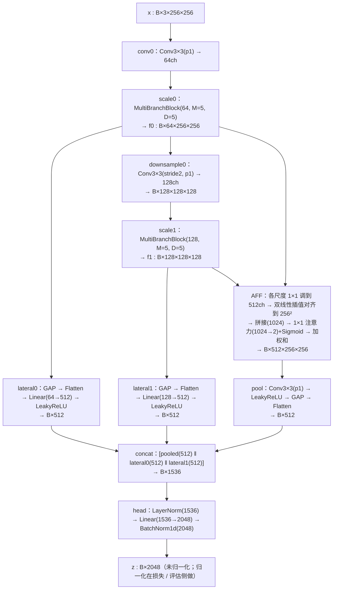
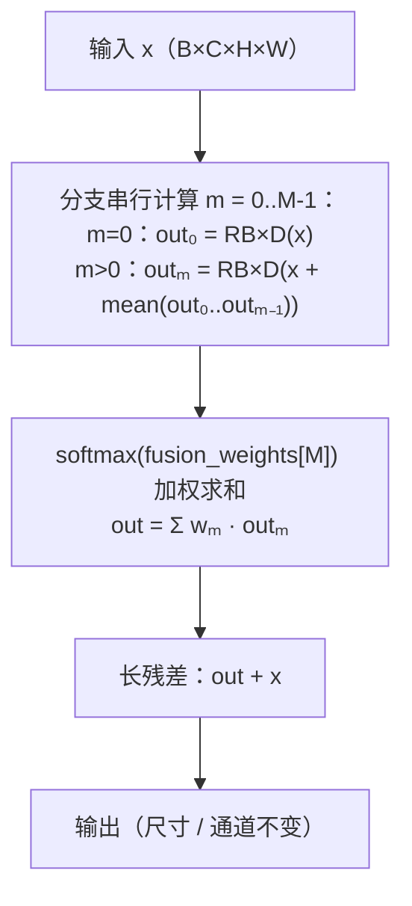
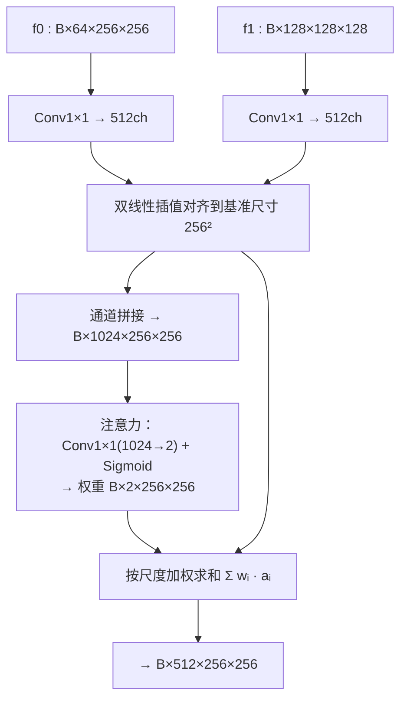
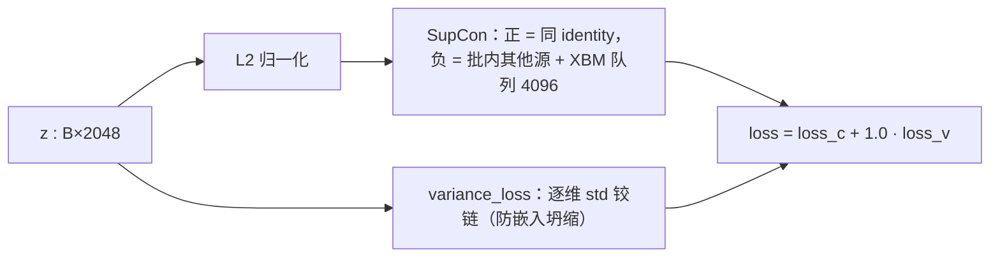
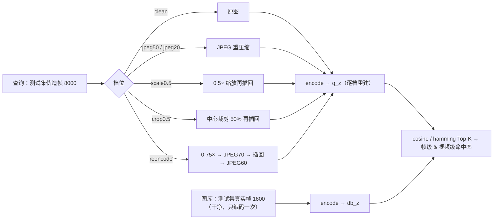

# AURA 模型结构设计图（mermaid）

> 用途：把 `aura/` 自建单编码器的**实际结构**画成图，供讨论 / 交接 / 写论文时参考。
> 维护约定：**代码是唯一事实来源**，本文件随结构改动同步更新（改动清单见文末「同步记录」）。
> 对应代码：[encoder.py](file:///d:/py/AURA/aura/encoder.py)、[data.py](file:///d:/py/AURA/aura/data.py)、[eval.py](file:///d:/py/AURA/aura/eval.py)、[train.py](file:///d:/py/AURA/aura/train.py)
> 日期：2026-10-17（C 轮：identity 监督 + 人脸掩膜擦除 + 多尺度跳连）

***

## 1. 端到端总览（数据 → 编码 → 损失 / 检索）

***

## 2. SourceEncoder 前向（全量规格：256px / M=5 / D=5 / 64ch / aff512 / embed2048）

> 注：`use_multiscale_skip=false` 时 `lateral` 为空，`head` 退化为 `LayerNorm(512) → Linear(512→2048) → BatchNorm1d`，即无跳连版（12.81M 参数）；开启后 15.02M。

***

## 3. MultiBranchBlock（主干的基本单元，M=5 分支 × D=5 残差块）

`ResidualBlock`（D 个串联）：`Conv3×3 → LeakyReLU → Conv3×3 → 残差相加 → LeakyReLU`。

***

## 4. AttentionFeatureFusion（AFF，把两个尺度对齐后按注意力加权）

***

## 5. 损失与检索

***

## 6. 退化鲁棒基准（六档，只作用于查询；图库保持干净）

***

## 7. 关键规格与工程决策（与图对照）

| 项 | 取值 | 说明 |
| --- | --- | --- |
| 输入 / 输出 | 256×256×3 → R^2048 | 整图输入，无前景/背景分离 |
| 主干 | M=5（分支）× D=5（残差块）× 2 尺度 | 沿用论文"全量规格"以保持可比性 |
| 通道 | 64ch（尺度0）→ 128ch（尺度1）→ aff 512 | |
| 多尺度跳连 | 每尺度降采样前的特征图 → GAP → Linear(·→512) | 「半个 U-Net」编码器侧；用**可学 lateral**而非原始像素，避免背景逐像素泄漏。当前轮**关闭**（`use_multiscale_skip: false`，12.82M）；开启后 head 输入 512→1536、参数 15.02M |
| 人脸擦除 | `erase_prob` 概率擦除人脸区（噪点/纯色/空洞/随机椭圆），阈值只在 (0.35,0.65) 随机 | BiSeNet 掩膜实测占画面约 **55%** 且近似二值（阈值抬到 0.7 面积仅 0.556→0.551），**强度只能靠 `erase_prob` 控**；当前轮 0.2 |
| head | LayerNorm → Linear → BatchNorm1d | LayerNorm 防 fp16 溢出根因；BN 打破初始对称性（防坍缩） |
| 前向精度 | 整段 **fp32**（`autocast(enabled=False)`） | fp16 下多分支激活幅值 O(1e3) 会溢出成 inf → NaN |
| 梯度检查点 | 开（训练态，`use_reentrant=False`） | 反向峰值 17.0GB → 7.6GB |
| 监督粒度 | 可配置 `label_key`，当前 **`source_id`**（具体源帧 `X_f{帧号}`）；`identity` 为粗粒度备选 | 与帧级判据对齐：同视频其余 7 帧从正样本变负样本。实测两种粒度下**每锚点均有 1 个正样本**（batch=4 → 批内 2 个类别），故"正样本为 0"被排除；真正的难点是"同视频相邻帧"这种近乎相同的极难负样本，故本轮 lr 减半、warmup 加倍 |
| batch / step | 2 源 × 2 张 = 4；800 步/轮 × 6 轮 | 300 源 → 每轮只过约 22% 数据 |
| 损失 | SupCon（tau=0.2）+ 1.0 × variance_loss | XBM 队列 4096 常驻 CPU |
| 评测 | 图库 1600 真实帧 / 查询 8000 伪造帧 | 帧级 = source_id 命中；视频级 = 同源 X |

***

## 8. 同步记录

| 日期 | 同步内容 |
| --- | --- |
| 2026-10-17 | 新建；对齐 C 轮结构（identity + 人脸擦除 + 多尺度跳连，15.02M）与退化基准六档 |
| 2026-10-17 | C 轮（erase 0.5 + 跳连）帧级 Top-1 e1 32.23% → e2 13.06% 崩盘；改单变量隔离轮 `_erase_lite`（仅擦除、`erase_prob` 0.2、跳连关闭、12.82M）。补记掩膜近似二值、面积约 55% 的实测 |
| 2026-10-18 | `label_key` 改为可配置（identity / source_id），当前轮 `_fine` 用 `source_id`；规格表「监督粒度」「人脸擦除」「batch/step」行同步。结构本身未变 |
